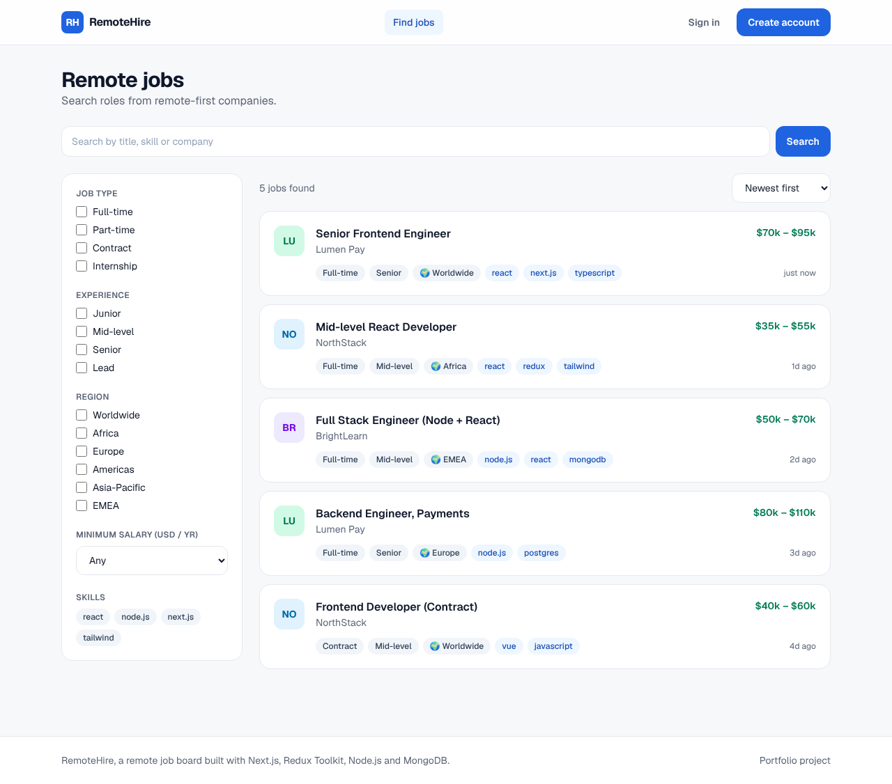
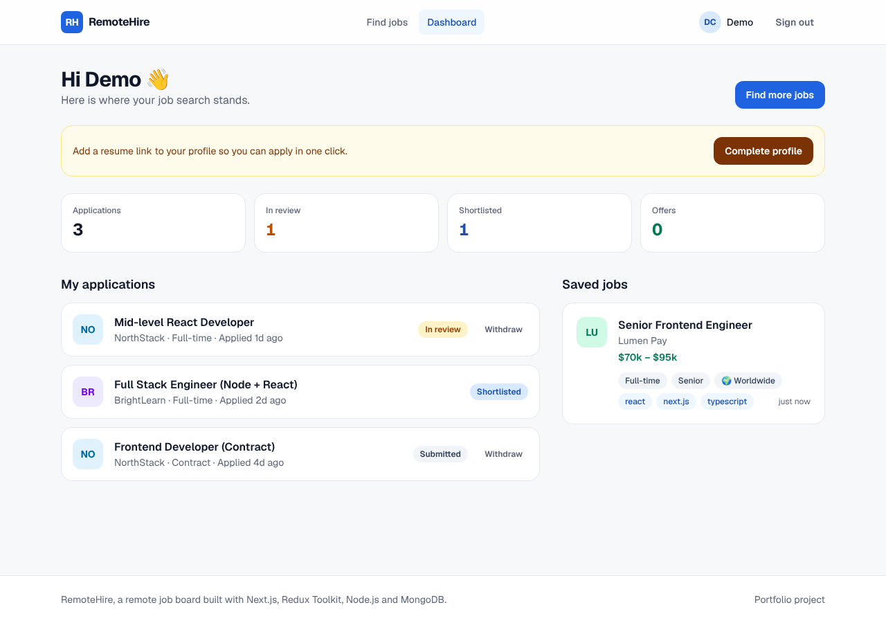
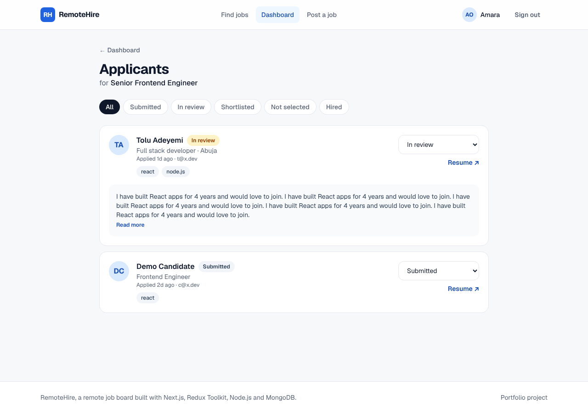

# RemoteHire: a full stack remote job board

RemoteHire connects remote-first companies with developers. Employers post jobs and move applicants through a hiring pipeline. Candidates search and filter roles, save jobs, apply in one click and track every application.

**Stack:** Next.js 16 (App Router) · React 19 · Redux Toolkit + RTK Query · Tailwind CSS 4 · Node.js · Express 5 · MongoDB + Mongoose · Zod · JWT (httpOnly cookies) · Vitest + Supertest



## Features

**Candidates**
- Search jobs by title, company or skill, with filters for job type, level, region, minimum salary and skills
- Filters live in the URL, so every search can be shared and bookmarked
- Worldwide roles appear under every region filter, so candidates never miss a job they can take
- Apply with a resume link (saved on the profile) and an optional cover letter
- Dashboard that tracks each application's status (submitted, in review, shortlisted, hired), with withdraw
- Save jobs for later

**Employers**
- Post, edit, close, reopen and delete jobs
- Dashboard with open roles, applicant totals and a per-job pipeline bar
- Review applicants by status, read cover letters and open resumes
- Move applicants through the pipeline; candidates see the change on their dashboard
- Company profile (name, logo, website, about) shown on every job

**Engineering**
- Role-based access control enforced on the API (employers cannot see other employers' applicants, candidates cannot post jobs)
- Zod validation on every request body and query, with field-level error messages shown in the UI
- JWT stored in an httpOnly cookie. Next.js proxies `/api/*` to Express, so the cookie is first-party in every environment
- Helmet, CORS allow-list, rate-limited auth routes, bcrypt password hashing, safe `?next=` redirects
- One application per candidate per job, enforced by a unique MongoDB index
- 14 API integration tests covering auth, search and filters, permissions and the full hiring flow
- GitHub Actions CI runs the API tests and the production build on every push

| Candidate dashboard | Employer dashboard |
| --- | --- |
|  |  |

| Applicant review | Mobile job page |
| --- | --- |
|  |  |

## Architecture

```
remotehire/
├── client/                 Next.js app (deploys to Vercel)
│   └── src/
│       ├── app/            Routes: /, /jobs, /jobs/[id], /dashboard, /dashboard/jobs/..., /profile, /login, /register
│       ├── components/     JobCard, JobForm, AuthForm, RequireAuth, dashboards, UI primitives
│       ├── store/          Redux store, RTK Query API slice (cache tags + invalidation), toast slice
│       └── lib/            Formatting helpers and shared constants
└── server/                 Express API (deploys to Render, Railway or Fly.io)
    ├── src/
    │   ├── models/         User, Job, Application (Mongoose)
    │   ├── controllers/    auth, jobs, applications, users
    │   ├── routes/         Route definitions with auth, role and validation middleware
    │   ├── middleware/     requireAuth, requireRole, validate (zod), error handler
    │   ├── utils/          Zod schemas, constants, ApiError
    │   └── scripts/seed.js Demo data
    └── tests/              Vitest + Supertest + in-memory MongoDB
```

Browser → Next.js (`/api/*` rewrite) → Express → MongoDB. RTK Query caches every response and uses tags to refetch only what a mutation changed. For example, changing an applicant's status refreshes the applicant list and the employer's pipeline stats, and nothing else.

## Data model

- **User**: name, email, password (bcrypt), role (`candidate` or `employer`), candidate profile (headline, skills, resumeUrl, savedJobs), employer company (name, logo, website, about)
- **Job**: employer, title, description, requirements, type, level, region, timezone, salary range, tags, status (`open` or `closed`), applicationsCount
- **Application**: job, candidate, employer, resumeUrl, coverLetter, status. Unique on `(job, candidate)`

## API

| Method | Route | Access | Purpose |
| --- | --- | --- | --- |
| POST | `/api/auth/register` | Public | Create a candidate or employer account |
| POST | `/api/auth/login` | Public | Sign in (sets cookie) |
| POST | `/api/auth/logout` | Public | Clear the session |
| GET | `/api/auth/me` | Signed in | Current user |
| PATCH | `/api/users/me` | Signed in | Update profile (fields depend on role) |
| GET | `/api/jobs` | Public | Search: `q, type, level, region, tags, minSalary, sort, page, limit` |
| GET | `/api/jobs/meta` | Public | Filter options, popular tags, counts |
| GET | `/api/jobs/:id` | Public | Job detail, plus viewer state (applied, saved, owner) |
| POST | `/api/jobs` | Employer | Post a job |
| PATCH / DELETE | `/api/jobs/:id` | Job owner | Edit, close or delete a job |
| GET | `/api/jobs/mine` | Employer | My jobs with pipeline counts |
| POST | `/api/jobs/:id/apply` | Candidate | Apply |
| GET | `/api/jobs/:id/applications` | Job owner | Applicants, optional `?status=` |
| PATCH | `/api/applications/:id/status` | Job owner | Move an applicant through the pipeline |
| GET | `/api/applications/me` | Candidate | My applications |
| DELETE | `/api/applications/:id` | Candidate | Withdraw (before a decision) |
| GET / PUT / DELETE | `/api/users/me/saved[/:jobId]` | Candidate | Saved jobs |

Errors always look like `{ "error": { "message": "...", "details": [{ "path": "...", "message": "..." }] } }`.

## Run it locally

You need Node.js 20 or newer and MongoDB (local, Docker, or a free MongoDB Atlas cluster).

```bash
# 1. Start MongoDB (or use an Atlas connection string in server/.env)
docker compose up -d

# 2. API
cd server
cp .env.example .env
npm install
npm run seed        # demo employers, candidates, jobs and applications
npm run dev         # http://localhost:4000

# 3. Web app (new terminal)
cd client
cp .env.example .env.local
npm install
npm run dev         # http://localhost:3000
```

Demo accounts (password `password123`), also available as one-click buttons on the sign-in page:
- Candidate: `candidate@remotehire.dev`
- Employer: `hiring@lumenpay.dev`

Run the API tests (they start an in-memory MongoDB, so nothing else is needed):

```bash
cd server && npm test
```

## Deploy

1. **Database**: create a free MongoDB Atlas cluster and copy its connection string.
2. **API**: deploy `server/` to Render (or Railway). Build command `npm install`, start command `npm start`. Set `MONGODB_URI`, `JWT_SECRET`, `NODE_ENV=production` and `CLIENT_ORIGIN=https://your-app.vercel.app`. Run `npm run seed` once if you want demo data.
3. **Web**: import the repo on Vercel with `client` as the root directory, and set `API_URL` to the API's URL. Because Vercel proxies `/api/*`, cookies work without any cross-site setup.

## What I would add next

- Resume file uploads with Supabase Storage or Firebase Storage instead of links
- Email notifications when an application's status changes
- Full-text search with MongoDB Atlas Search
- Company pages listing all of a company's open roles
